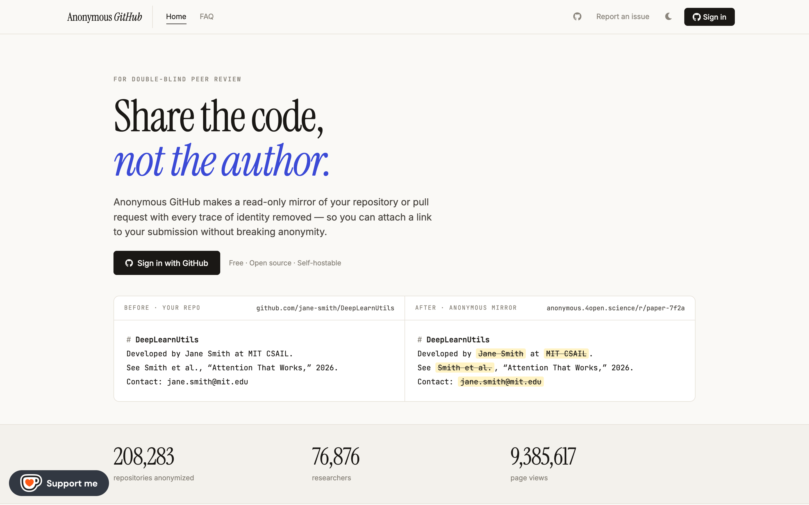

<div align="center">

# Anonymous GitHub

**Share your code and data for double-anonymous peer review — without giving your identity away.**

[](https://www.npmjs.com/package/@tdurieux/anonymous_github)
[](LICENSE)
[](https://anonymous.4open.science/)
[](https://github.com/tdurieux/anonymous_github/stargazers)

[**Public instance**](https://anonymous.4open.science/) · [How it works](#how-it-works) · [Self-hosting](#self-hosting)



</div>

## Why

Double-anonymous review asks you to anonymize the artifact behind your paper — the code and data — exactly like the paper itself. Doing that by hand (owner, organization, repository name, logins, and every mention buried in the files) is tedious and easy to get wrong. Anonymous GitHub does it for you and serves the result behind a shareable link.

A free public instance is available at **[anonymous.4open.science](https://anonymous.4open.science/)**.

## What it anonymizes

- The GitHub **owner, organization, and repository name**
- **File and directory names**
- **File contents** of every extension (Markdown, text, source code, …), replacing a configurable list of terms. Files you choose under "Unredacted files" (e.g. `paper/refs.bib`, or a pattern such as `*.bib`) keep their content as written, so redacted self-citations do not single out the authors; their names are still redacted

## Usage

### Public instance

Just open **[anonymous.4open.science](https://anonymous.4open.science/)**, paste your repository URL, add the terms to hide, and share the generated link.

### Git submodules

Direct public GitHub submodules are included in the file browser and ZIP downloads
at the commit recorded by the parent repository. Their paths and contents use the
parent's anonymization settings. `.gitmodules` files are omitted from shared GitHub
content because they contain source repository URLs.

The service expands up to 20 direct submodules and 10,000 combined child tree entries.
Private, non-GitHub, nested, missing, oversized, and truncated submodules remain empty
folders with a warning. Child files are fetched anonymously on demand; child tree
lookups use GitHub's unauthenticated API quota. ZIP downloads fetch public child archives.
Existing cached repositories with `.gitmodules` rebuild their file trees on the next
listing or ZIP download. No manual database migration is required.

### CLI

Anonymize a repository locally and produce an anonymized zip:

```bash
npm install -g @tdurieux/anonymous_github
anonymous_github
```

### LLM and automation clients

Use expiring, repository-scoped maintenance tokens to inspect saved status,
edit anonymization settings, refresh snapshots, and extend expiration.
A signed-in owner or coauthor can issue and revoke tokens through
`/api/user/maintenance-tokens`. See the [client guide](public/llms.txt) and
[OpenAPI description](public/maintenance-openapi.json), also served at
`/llms.txt` and `/maintenance-openapi.json` on each instance.
These tokens cannot access GitHub previews, file downloads, or admin routes.

## Self-hosting

On this migration branch, Docker runs the Go backend, including streaming and background workers. The branch includes current `main` sources, but newer billing, preview, and email APIs still need Go implementations; see the [alignment status](backend/README.md#branch-alignment-status-november-14-2026). See the [Go deployment and cutover guide](backend/README.md#default-deployment) before upgrading an existing installation. It covers queue handoff, storage permissions, staging checks and the preserved Node rollback stack. A full production staging rehearsal is still required before cutover.

The following Node instructions also support the CLI, asset build and rollback backend.

Local installation requires Node.js 22.15 or newer in the 22.x series,
24.x, or 26 or newer. Run `npm ci` and `npm run build` to install and build.
`npm run dev` uses Node's watch mode; `npm run build:ui` rebuilds browser assets.

For the November 2026 dependency update, install from the committed lockfile
with `npm ci`, rebuild with `npm run build`, and restart the API and streamer
services together. Docker installations should rebuild the application image.
This dependency update does not change MongoDB documents, Redis keys, or queue
formats, so it requires no production data migration. Existing credential
migration requirements still apply when upgrading from an older release.

The [`glob`](https://github.com/advisories/GHSA-3g3m-2fjr-6pw4) and
[`minimatch`](https://github.com/advisories/GHSA-g3hv-75wg-m249) overrides select security fixes unavailable through
the dependency ranges of archive and development tools. Keep them until those
packages accept patched versions. CI checks the full dependency audit and runs
MongoDB migration, Redis session, and archive compatibility tests on Node 22
and 24. To run the database tests locally, point `TEST_MONGODB_URI` and
`PERFORMANCE_MONGO_URI` at disposable MongoDB databases and set
`PERFORMANCE_REDIS_PORT` to a disposable Redis instance. The performance database
name must begin with `perf_test_`; these tests delete their test data.

<details>
<summary>Run your own instance with Docker</summary>

**1. Clone and install**

```bash
git clone https://github.com/tdurieux/anonymous_github/
cd anonymous_github
npm i
```

**2. Configure GitHub access** — create a `.env` file:

```env
GITHUB_TOKEN=<GITHUB_TOKEN>
CLIENT_ID=<CLIENT_ID>
CLIENT_SECRET=<CLIENT_SECRET>
CREDENTIAL_KEYS='{"2026-09":"<base64-encoded 32-byte random key>"}'
CREDENTIAL_ACTIVE_KEY_ID=2026-09
CREDENTIAL_LEGACY_READS=false
PORT=5000
DB_USERNAME=
DB_PASSWORD=
AUTH_CALLBACK=http://localhost:5000/github/auth
SESSION_SECRET=<random-session-secret>
COOKIE_SECURE=false
```

- `GITHUB_TOKEN` — create one at <https://github.com/settings/tokens/new> with the `repo` scope.
- `CREDENTIAL_KEYS` / `CREDENTIAL_ACTIVE_KEY_ID` — generate a key with `openssl rand -base64 32`. Existing installations must follow the [credential migration guide](docs/credential-encryption.md) before starting this release.
- `CLIENT_ID` / `CLIENT_SECRET` — from an OAuth App at <https://github.com/settings/applications/new>.
- The App's callback must be `https://<host>/github/auth` (matching `AUTH_CALLBACK`).

To enable read-only access to selected private repositories alongside OAuth, follow
the [GitHub App setup guide](docs/github-app-setup.md).

**3. Start the server**

```bash
install -d -m 0750 -o 10001 -g 10001 repositories
docker compose up -d --build
```

The storage command requires permission to set ownership. For an existing storage directory, apply your ownership or ACL policy without replacing its contents. Use `COOKIE_SECURE=true` with HTTPS in production.

**4. Open** <http://localhost:5000>. The port can be changed in `docker-compose.yml`; putting Anonymous GitHub behind nginx is recommended for HTTPS.

For an optional remote, hidden, delayed MongoDB replica and backup source, see
the [MongoDB replication guide](docs/mongodb-replication.md).

</details>

### Owner email alerts

Set `RESEND_API_KEY` and `EMAIL_FROM` on the web server and download workers to
send access alerts through [Resend](https://resend.com/docs/api-reference/emails/send-email).
Use a sender address on a domain verified in Resend. `APP_HOSTNAME` sets the
host used for the connections link in emails.

Registration saves a verified GitHub email address, preferring the primary address.
OAuth requests `user:email`; GitHub App sign-in uses the read-only email permission
described in the setup guide. Later sign-ins also fill missing addresses. Saved
addresses and custom alert addresses are preserved. GitHub privacy placeholder
addresses are not imported.

Signed-in owners without an email address see an email form in a popup.
“Remind me later” dismisses it for the current login session; “Never” saves a
permanent preference on the account. Existing addresses are reused, and owners
can add or change their address on the connections page at any time.
Alerts cover invalid GitHub credentials and repository access errors encountered
while reading or refreshing content. No periodic access scan is performed.
Emails contain no repository names, anonymous URLs, or credentials.

An atomic recipient claim allows one email attempt per normalized address across
repositories, pull requests, gists and accounts. Suppression has no time expiry.
Sign-in, reconnecting, successful access recovery, resource removal or expiration,
and disabling the original account retain suppression for that address. Inactive
resources cannot trigger new alerts. Changing to an address that has never been
notified permits its first alert.

Failed deliveries and interrupted sends whose outcome is unknown also stay
blocked to avoid duplicate delivery. Unsent claims can be cancelled by confirmed recovery before dispatch. Bookkeeping failures
release claims when no provider request has started. Pending claims interrupted
before dispatch can be reclaimed after a 60-second lease during startup or a new
notification attempt. Claim identity and state checks prevent a paused sender
from dispatching after another instance reclaims its claim. Cancellation is saved
before cleanup; matching legacy fields are cleared before the guard is released.
Interrupted cleanup resumes on startup or a later notification. Legacy fields
carry an attempt ID so unrelated deliveries and newer generations are preserved.
A resource revision prevents delayed preparation from recreating a reclaimed
claim. All asynchronous preparation stays pending. A sending reservation is
reclaimable until dispatch commits atomically on the owner document, against its
reset revision and lease, immediately before contacting the provider. Cancellation
competes with that same commitment, so a paused sender cannot dispatch afterward.
Owner dispatch records distinguish known-unsent reservations from interrupted
committed sends. Completed records are removed; expired uncommitted records are
pruned on later attempts. Persistent reset revisions also fence attempts created
while a reset is in progress, even when no recipient guard existed at its start.
Recovery recorded during an active reset is retried when reset finishes or its
lease expires, with the original source and revision checks.
Provider idempotency keys
and redacted attempt records support auditing without storing recipient addresses
or repository names in the audit log. Records include owner and resource IDs,
resource kind, generation and a categorized access failure to identify the
trigger without exposing the address. Attempt records are saved before dispatch,
with completion recorded separately. Existing resource claims are migrated to
recipient guards before new application instances serve requests using an indexed
scan with resumable checkpoints. Other instances wait while its lease is healthy,
and take over if the lease expires.
Every existing resource claim is retained behind the recipient guard. Recovery
marks claims recovered without authorizing another email. Completed provider
results are recorded before guard updates, with bounded retries and reconciliation
on startup or a later notification. The upgrade restores missing recipient guards
from immutable provider completion records, including guards previously released
by recovery or resource removal. This history scan uses an index and resumable
checkpoints and does not send email. Its `recipient-alerts-v2` database marker is
independent of the v1 marker, so cold starts also restore missing suppression.
Resource lifecycle mutations advance the owner dispatch fence and block new
attempts until the status write completes. Concurrent mutations keep separate
reservations. Failed or ambiguous status writes retain suppression for that
owner; run the offline reconciliation command below after stopping all writers
to clear interrupted reservations safely.

Use `scripts/deploy.sh` when upgrading recipient alert suppression. The new image
has the `science.4open.owner-alert-protocol=recipient-v2` label. When running
application containers have an older or missing protocol label, the script builds
the replacement, stops and verifies all old API and streamer containers, then prepares a full claim
reconciliation and starts the new streamers and API. Stopped legacy containers
from a rollback also trigger reconciliation, so claims written after an earlier
migration are included. This path also runs when retrying with an already-built
image and `FORCE=0`. Once writers are stopped, preparation releases all known
unsent pending claims and clears their matching legacy fields before backfill.
This upgrade pauses traffic while claims migrate and allows up to 15
minutes for startup, configurable with `MIGRATION_HEALTH_TIMEOUT`. Subsequent
deployments keep the usual rolling streamer replacement. Manual upgrades must
stop all application writers, run
`docker compose run --rm --no-deps --entrypoint node anonymous_github ./build/scripts/reconcile-legacy-owner-alerts.js`
using the new image, and then start the new application instances. Run this
preparation after legacy writers have operated, even if their containers were
already removed. Ordinary restarts preserve confirmed recoveries.
Leaving either Resend setting empty disables delivery and the email prompt.

## Scope of anonymization

In double-anonymous review, the boundary of anonymization is **the paper plus its online appendix — and only that**. Googling part of the paper or appendix to reveal authorship is considered a deliberate attempt to break anonymity ([explanation](https://www.monperrus.net/martin/open-science-double-blind)).

## How it works

Anonymous GitHub either downloads the full repository and anonymizes each file, or proxies requests to GitHub on the fly. In both cases the original and anonymized versions are cached on the server, so even large repositories stay responsive.

## Related tools

- [gitmask](https://www.gitmask.com/) — contribute anonymously to a GitHub repository.
- [blind-reviews](https://github.com/zombie/blind-reviews/) — browser add-on that hides identifying information when reviewing a pull request.

## See also

- [Open science and double-anonymous peer review](https://www.monperrus.net/martin/open-science-double-blind)
- [ACM policy on double-blind reviewing](https://dl.acm.org/journal/tods/DoubleBlindPolicy)

## License

[GPL-3.0](LICENSE) © [Thomas Durieux](https://durieux.me)

### Frontend development

The UI uses Vue 3 and Vue Router with the existing Express API. Page setup
functions live in `public/script/app.js` and `admin.js`; the Vue templates are
in `public/partials/`. Gulp compiles the templates and bundles the app with
esbuild, then updates the asset manifest used by Express.

Run `npm run build:ui` after changing a template or frontend script. Use
`npm run dev:ui` to serve the built UI locally with API requests proxied to the
configured upstream. `npm run test:ui` rebuilds the assets and runs the frontend
regression and DOM interaction tests. `npm run build` also builds the UI for
production.

The initial bundle contains the Vue app. Markdown extensions load on content
routes; PDF.js, Ace, and notebook support load when their viewers mount.
Org support loads in the repository explorer, and Mermaid loads only when a
diagram is encountered. These libraries use hashed URLs and load once per tab.

The Docker build compiles the same bundles and copies them, the asset manifest,
and document-worker assets into the runtime image. The Compose app serves these
assets directly; no frontend development server is needed.

### Paid hosting

Optional Stripe billing supports monthly and annual author subscriptions, repository review passes, and prepaid conference packages. Billing is disabled by default. See the [setup and rollout guide](docs/paid-hosting.md) for prices, capacities, webhooks, migration behavior, and test-mode verification.
